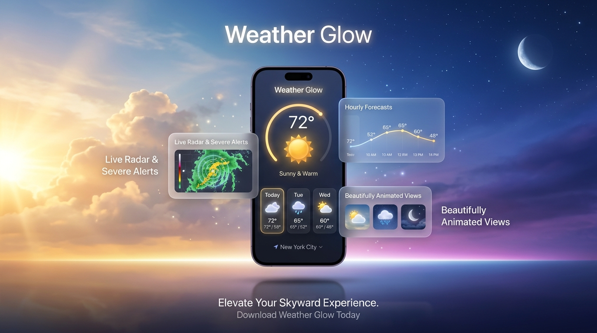
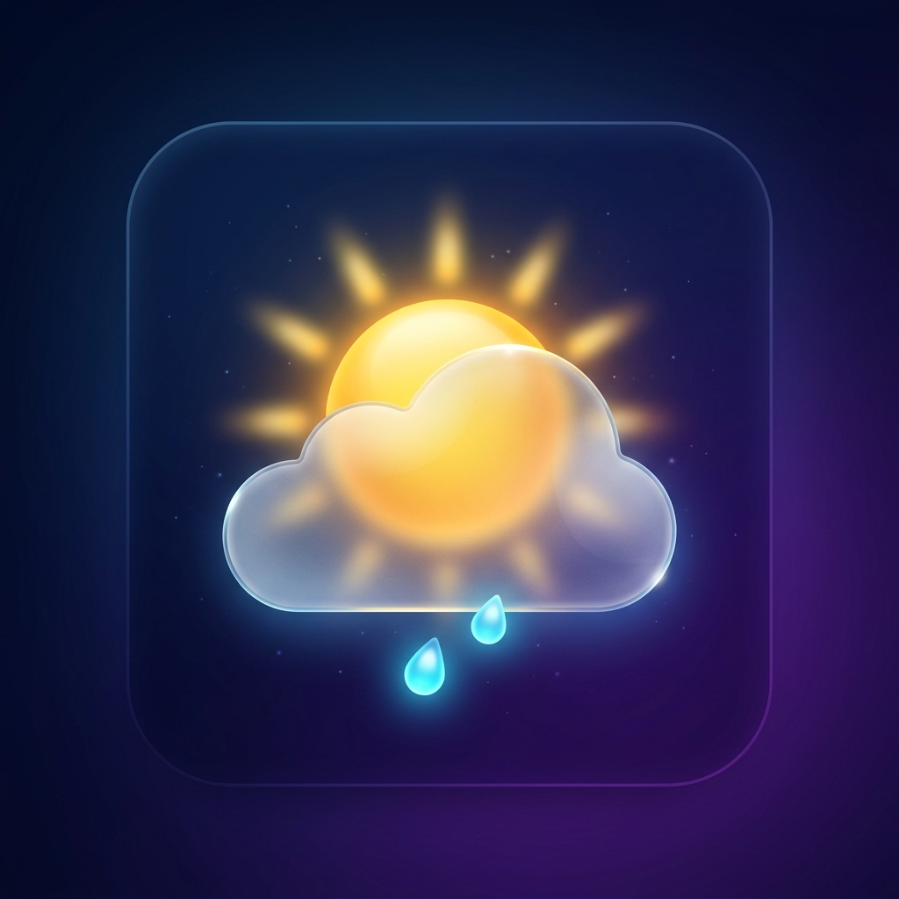

# ☀️ Weather Glow (Atmosphere)

<p align="center">
  
</p>

<p align="center">
  
</p>

<p align="center">
  <b>Ứng dụng theo dõi thời tiết thế hệ mới với đồ họa Vector Animation & giao diện Glassmorphism đỉnh cao.</b>
</p>

<p align="center">
  <a href="https://github.com/maico-le/weather/releases/latest">
    
  </a>
  <a href="https://github.com/maico-le/weather/actions">
    
  </a>
  <a href="https://github.com/maico-le/weather/releases">
    
  </a>
</p>

---

## 🌟 Điểm Nhấn Đột Phá

### 1. Vector Animation (Lottie & Custom Canvas Vector)
- **Chuẩn mực 60 / 120 FPS**: Không sử dụng ảnh tĩnh nhạt nhòa, Weather Glow ứng dụng hoạt hình vector chuyển động siêu mượt mà.
- **Tương tác trực quan**: Mặt trời xoay tỏa hào quang rực rỡ, những đám mây trôi bồng bềnh, những giọt mưa rơi tí tách và những tia chớp sống động ngay trên màn hình.

### 2. Thiết Kế Dynamic Glassmorphism
- **Kính mờ sang trọng (Frosted Glass)**: Hệ thống card hiển thị ứng dụng công nghệ làm mờ Gaussian đa tầng cùng hiệu ứng viền sáng tinh tế.
- **Bầu trời đổi màu theo thời gian thực (Dynamic Sky)**: Màu nền tự động chuyển dịch theo nhịp điệu thiên nhiên:
  - 🌅 **Nắng vàng quang đãng**: Xanh ngọc bích hòa cùng ánh cam hổ phách.
  - 🌧️ **Mưa rào & Âm u**: Xám lam thạch anh huyền bí.
  - ⚡ **Dông sét dữ dội**: Sắc tím ánh điện quyền lực.
  - 🌙 **Màn đêm tĩnh lặng**: Xanh thẫm đại dương thanh bình.

### 3. Tương Tác Chạm Bầu Trời Động (Interactive Weather Sky)
- **Hiệu ứng sóng hào quang thiên thể (Celestial Ripple)**: Chạm hoặc vuốt ngón tay lên bầu trời sẽ tạo ra luồng ánh sáng và sóng tỏa lan tỏa huyền ảo.
- **Hạt ánh sáng lơ lửng (Ambient Atmospheric Dust)**: 25 hạt ánh sáng sinh học trôi bồng bềnh theo chuyển động không khí.

### 4. Tự Động Định Vị Vị Trí Hiện Tại Bằng GPS
- **Một chạm nhận diện**: Nút định vị GPS thông minh trên thanh tiêu đề tự động quét tọa độ kinh độ/vĩ độ chính xác từ thiết bị để cập nhật thời tiết tại nơi bạn đang đứng.

### 5. Cảnh Báo Thời Tiết Nguy Hại (Smart Extreme Alerts)
- Tự động phân tích dữ liệu khí tượng theo thời gian thực để đưa ra khuyến cáo kịp thời:
  - ⚠️ **Chỉ số UV nguy hại (>= 8)**: Cảnh báo nguy cơ bỏng rát da và khuyến nghị bảo hộ.
  - ⚡ **Dông bão & Lốc sét**: Nhắc nhở tìm nơi trú ẩn an toàn.
  - 🌧️ **Mưa rào sắp tới**: Dự báo trước mưa rào trong 2-3 giờ kế tiếp.
  - 💨 **Gió giật mạnh**: Cảnh báo khi tốc độ gió vượt 35 km/h.

### 6. Thông Số Khí Tượng Chuẩn Xác & Toàn Diện
- **Dự báo theo giờ (Hourly Timeline)**: Nắm bắt chi tiết nhiệt độ và xác suất mưa từng khung giờ trong ngày để chủ động mọi lịch trình.
- **Dự báo các ngày tới (Multi-day Forecast)**: Xem xu hướng thời tiết, biên độ nhiệt độ Cao / Thấp trực quan qua thanh dải màu.
- **Bộ 6 chỉ số môi trường thông minh**:
  - 💧 **Độ ẩm không khí**
  - 💨 **Tốc độ gió & Hướng gió**
  - ☀️ **Chỉ số UV an toàn cho da**
  - 🌡️ **Áp suất khí quyển**
  - 👁️ **Tầm nhìn xa**
  - ☁️ **Độ che phủ mây**
- **Sẵn sàng cho Widget màn hình chính (Home Widget Preview)**: Giao diện thẻ kính mờ nhỏ gọn, hiện đại tương thích phong cách Android AppWidget và iOS WidgetKit.

---

## 📥 Tải Xuống Ứng Dụng

Bạn có thể tải ngay file cài đặt Android APK chính thức để trải nghiệm:

👉 **[Tải xuống Weather Glow APK mới nhất](https://github.com/maico-le/weather/releases/latest)**

*Lưu ý: Sau khi tải file `.apk`, chọn **Cho phép cài đặt từ nguồn này** trên điện thoại Android của bạn để hoàn tất cài đặt.*

---

## 📱 Trải Nghiệm Giao Diện

```
┌──────────────────────────────────────────────┐
│  📍 Ho Chi Minh City ▾            📡  🔍     │
│                                              │
│  ⚠️ CẢNH BÁO TIA UV NGUY HẠI (8/11+)          │
│                                              │
│               ☀️ (Vector Animation)           │
│                                              │
│                    28°C                      │
│             Trời quang, nắng đẹp             │
│        Cảm giác như 31° • Cao: 33° Thấp: 25° │
│                                              │
│ ┌──────────────────────────────────────────┐ │
│ │ DỰ BÁO THEO GIỜ                          │ │
│ │ Bây giờ    03:00    06:00    09:00       │ │
│ │   ☀️        ⛅       🌧️       🌤️         │ │
│ │   28°       26°      25°      29°        │ │
│ └──────────────────────────────────────────┘ │
│                                              │
│ ┌──────────────────────────────────────────┐ │
│ │ DỰ BÁO CÁC NGÀY TỚI                      │ │
│ │ Hôm nay   ☀️  25° ═══════ 33°             │ │
│ │ Ngày mai  🌧️  24° ═════ 31°              │ │
│ └──────────────────────────────────────────┘ │
│                                              │
│ ┌───────────────────┐  ┌───────────────────┐ │
│ │ 💧 ĐỘ ẨM          │  │ 💨 GIÓ            │ │
│ │ 85%               │  │ 8 km/h NE         │ │
│ └───────────────────┘  └───────────────────┘ │
└──────────────────────────────────────────────┘
```

---

## 🗺️ Lộ Trình Phát Triển (Milestones)

- [x] **Milestone 1**: Khởi tạo kiến trúc Feature-First, cấu hình CI/CD tự động build APK release trên GitHub Actions.
- [x] **Milestone 2**: Tích hợp nguồn dữ liệu thời tiết wttr.in JSON, tối ưu hóa bộ mapper dữ liệu & tiếng Việt hóa ngữ cảnh.
- [x] **Milestone 3**: Thiết kế giao diện Glassmorphism cao cấp, tích hợp Vector Animation (Lottie & Custom Canvas Vector 60fps), dự báo theo giờ & nhiều ngày.
- [x] **Milestone 4**: Tích hợp tương tác chạm bầu trời động (Interactive Weather Sky), hiệu ứng gợn sóng thiên thể & hạt ánh sáng chuyển động.
- [x] **Milestone 5**: Tự động định vị GPS (Geolocator), xem trước tiện ích ngoài màn hình chính (Home Screen Widget).
- [x] **Milestone 6**: Banner cảnh báo thời tiết cực đoan thông minh (Dông sét, UV nguy hại, mưa lớn, gió bão).

---

## 🛠️ Công Nghệ Phát Triển

- **Framework**: Flutter 3 (Engine tối ưu hóa Material 3)
- **Ngôn ngữ**: Dart
- **Đồ họa**: Lottie Vector Animation, Rive & Flutter Custom Canvas Painter
- **Kiến trúc**: Feature-first / Clean Architecture
- **Định vị**: Geolocator (GPS Native Service)
- **CI/CD**: GitHub Actions tự động build & release APK

---

<p align="center">
  Phát triển với ❤️ bởi <b>Maico Le</b>
</p>
